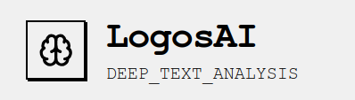

<div align="center">
  
</div>

# LogosAI

LogosAI is a source-grounded AI reading workspace for difficult texts. Import a
text, select a passage for help, run a close reading, and keep notes and AI
outputs attached to the source context.

## Run locally

```bash
make up
```

Open <http://localhost:5173>. Use `make logs` to follow service output and
`make down` to stop the stack. The stack seeds a local test account with a sample
reading; its credentials are in
[`cloudflare/fixtures/local-test-account.json`](./cloudflare/fixtures/local-test-account.json).

For hot reload and local secrets, see
[Cloudflare Operations](./cloudflare/README.md#local-setup).

## Docs

- [AGENTS.md](./AGENTS.md): engineering rules, verification commands, and where
  each kind of documentation belongs.
- [Project Reference](./docs/project.md): product boundaries, architecture, and
  runtime contracts.
- [Roadmap](./docs/roadmap.md): priorities and evidence gates.
